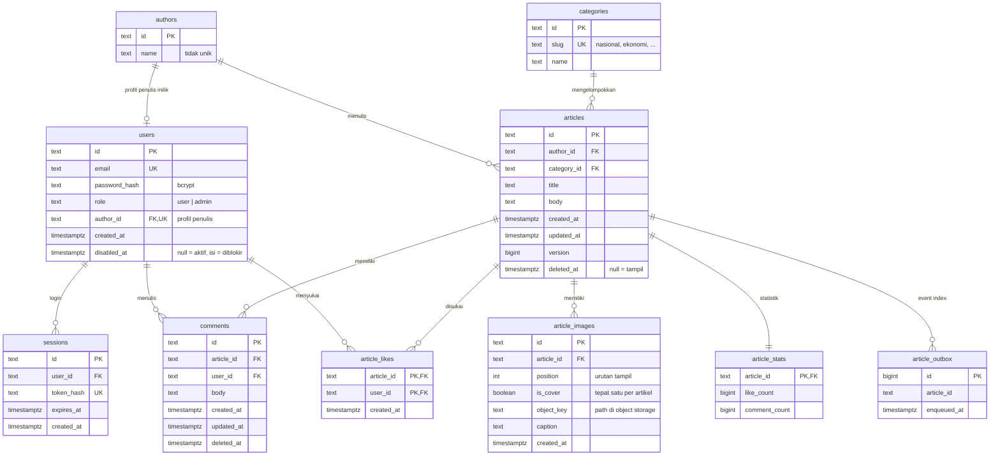

# ERD dan Keputusan Desain: Akun, Komentar, Like

Dokumen ini merancang pengembangan setelah technical test: registrasi dan login, tiga role (guest, user, admin), komentar, dan like. Tabel dan query yang sudah dioptimasi untuk constraint soal (`authors`, `articles`, `article_outbox`) dipertahankan.

## Diagram

## Role dan hak akses

Ada tiga role. **Guest** tidak disimpan di database: guest berarti request tanpa session. Yang disimpan di `users.role` hanya `user` dan `admin`. Admin pertama dibuat lewat seed atau environment variable, bukan lewat registrasi.

| Aksi | Guest | User | Admin |
|---|---|---|---|
| Baca feed, search, filter, komentar | Ya | Ya | Ya |
| Registrasi, login | Ya | | |
| Buat artikel | | Ya | Ya |
| Edit artikel | | Milik sendiri | Semua |
| Hapus artikel | | Milik sendiri | Semua |
| Komentar | | Ya | Ya |
| Edit komentar | | Milik sendiri | Semua |
| Hapus komentar | | Milik sendiri | Semua |
| Like / unlike | | Ya | Ya |
| Blokir user | | | Ya |

## Keputusan desain

### 1. `users` dipisah dari `authors`

- `users` adalah akun login: email unik, password, role.
- `authors` adalah nama penulis yang tampil di artikel. Nama tetap tidak unik (constraint #3).
- Registrasi membuat satu baris `users` dan satu baris `authors` dalam satu transaksi.
- Author tanpa akun tetap valid, misalnya akun syndication yang diimpor dari kantor berita. Karena itu relasinya satu author punya nol atau satu akun.
- Tabel `articles` dan query yang sudah dioptimasi (`LATERAL`, index per author) tidak berubah.
- Endpoint `POST /authors` dihapus, karena author kini dibuat lewat registrasi.

### 2. Autentikasi memakai session di database, bukan JWT

- Saat login, server membuat token acak dan mengirimnya lewat cookie `HttpOnly; Secure; SameSite=Lax`. JavaScript di browser tidak bisa membaca cookie ini, sehingga token tidak bisa dicuri lewat XSS.
- Database hanya menyimpan hash SHA-256 dari token (`sessions.token_hash`). Kebocoran isi database tidak langsung memberi akses login.
- Logout dan blokir user langsung berlaku: cukup hapus baris session. Dengan JWT, token tetap valid sampai kedaluwarsa.
- Biayanya satu query per request yang butuh login. Request baca dari guest tidak membawa session, jadi tidak ada biaya tambahan di jalur baca yang paling ramai.
- Password di-hash dengan bcrypt.
- Karena frontend berada di origin yang sama (proxy Vite di development, reverse proxy di produksi), cookie bekerja tanpa konfigurasi CORS.
- Untuk mencegah CSRF pada request yang mengubah data, cookie memakai `SameSite=Lax` dan API hanya menerima `Content-Type: application/json` untuk request tersebut.

### 3. Like memakai primary key gabungan `(article_id, user_id)`

- Satu user hanya bisa like satu artikel satu kali, dan aturan ini dijaga database.
- Klik dobel atau dua request bersamaan tidak membuat like dobel. Request kedua kena unique violation dan diperlakukan sebagai "sudah like", sehingga operasinya idempotent.
- Unlike adalah `DELETE`, juga idempotent.

### 4. Counter disimpan di tabel terpisah `article_stats`

- `like_count` dan `comment_count` diubah secara atomik (`like_count = like_count + 1`) dalam transaksi yang sama dengan insert atau delete like/komentar. Tidak ada lost update.
- Counter tidak disimpan di `articles`, karena baris artikel berisi `body` yang besar dan Postgres menulis ulang seluruh baris pada setiap update. Perubahan counter juga tidak perlu memicu reindex Elasticsearch.
- Untuk artikel viral, baris `article_stats` bisa menjadi hot row. Jalur peningkatannya: kumpulkan perubahan di memori lalu tulis per batch, atau pindahkan counter ke Redis.

### 5. Komentar memakai keyset pagination

Index `(article_id, created_at DESC, id DESC)`, dengan pola yang sama seperti feed artikel. Komentar bisa diedit, dan `updated_at` dipakai untuk menampilkan label "diedit".

### 6. Soft delete untuk moderasi

- Artikel dan komentar yang dihapus diberi `deleted_at`, tidak dihapus fisik, sehingga tetap ada untuk audit.
- Query baca menyaring `deleted_at IS NULL`.
- Penghapusan artikel juga masuk `article_outbox`. Indexer diperluas: kalau `deleted_at` terisi, dokumen dihapus dari Elasticsearch.

### 7. Kategori (rubrik)

- Tabel `categories` berisi daftar rubrik tetap (Nasional, Ekonomi, Teknologi, Gaya Hidup, Olahraga) dengan `slug` unik untuk URL (`?category=ekonomi`).
- Setiap artikel punya satu kategori (`articles.category_id`, wajib diisi saat menulis).
- Index baru `(category_id, created_at DESC, id DESC)` membuat feed per rubrik berhenti setelah `LIMIT` baris, dengan pola yang sama seperti index per author.
- Dokumen Elasticsearch mendapat field `category` bertipe `keyword`, sehingga pencarian bisa difilter per rubrik dengan klausa `term`.
- Filter kategori bisa digabung dengan `query` dan `author`, dan tetap memakai cursor pagination ("Lebih baru" / "Lebih lama"). Nomor halaman tidak dipakai karena keyset pagination tidak bisa melompat ke halaman tertentu tanpa membaca semua baris sebelumnya.

### 8. Gambar artikel (bisa banyak)

- Satu artikel bisa punya sampai 5 gambar, disimpan di tabel `article_images`. Penulis mengatur urutan dengan drag-and-drop (kolom `position`), memberi keterangan per gambar, dan memilih satu gambar sebagai sampul (`is_cover`). Sampul tidak harus gambar pertama.
- Batas 5 gambar dicek di service dan di database (trigger atau pengecekan `COUNT` dalam transaksi yang sama dengan insert).
- Constraint unik `(article_id, position)` menjaga urutan tidak bentrok. Unique partial index `(article_id) WHERE is_cover` menjamin tepat satu sampul per artikel di tingkat database. Index `(article_id, position)` membuat gambar satu artikel terambil dalam satu range scan.
- Mengubah urutan dikirim sekali sebagai daftar id terurut (`PUT /articles/{id}/images/order`), lalu disimpan dalam satu transaksi, sehingga tidak ada keadaan setengah terurut.
- Feed cukup mengambil gambar sampul plus jumlah gambar (untuk penanda "2 foto"). Galeri lengkap hanya dimuat di halaman artikel.
- File gambar tidak disimpan di Postgres. Gambar disimpan di object storage yang kompatibel dengan S3: SeaweedFS di Docker Compose untuk development, S3 atau GCS di produksi. Postgres hanya menyimpan `object_key`, yaitu path objeknya.
- Unggahan dibatasi maksimal 5 gambar per artikel, format JPG, PNG, atau WebP, maksimal 5 MB per gambar. Tipe file dicek dari isi file, bukan dari nama atau header yang dikirim klien.
- Server meng-encode ulang gambar menjadi JPEG dalam dua ukuran: thumbnail 480x300 untuk feed dan versi besar maksimal 1600px untuk halaman artikel. Feed tidak pernah mengunduh gambar ukuran penuh. Encode ulang juga membuang metadata (misalnya lokasi GPS) dari foto. JPEG dipilih karena encoder WebP di Go butuh cgo.
- Nama objek memakai id artikel dan id gambar (`articles/{article}/{image}/thumb.jpg`), sehingga isi sebuah URL tidak pernah berubah dan bisa di-cache browser serta CDN dalam waktu lama (`Cache-Control: immutable`). Menghapus satu gambar juga tidak mungkin menghapus file milik artikel lain.
- Gambar bersifat opsional. Artikel tanpa gambar tetap tampil normal, tanpa kotak kosong.
- Profil user (foto profil) belum dibuat. Nama dan inisial sudah cukup untuk tahap ini.

### 9. Blokir user

`users.disabled_at` diisi oleh admin. Semua session user tersebut dihapus, dan login berikutnya ditolak. Artikel dan komentar yang sudah ada tetap tampil kecuali admin menghapusnya.
